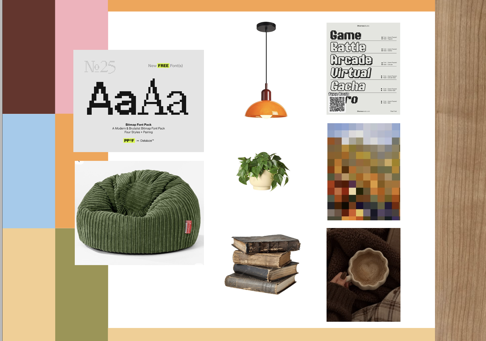

# Pixel Home — richt je eigen huisje in

Een gezellig pixel-art huisje in 3D dat je helemaal zelf inricht. Het is een single-page site, gebouwd met **Vite + three.js**. Je draait en zoomt rond het huis en klikt op meubels (beneden sofa, bureau en keuken, boven bed, douche en make-uptafel) om hun model en kleuren te veranderen. Een korte tutorial in een pixel-stripballon legt alles uit.

- **Live:** https://lisamariemaxine-bot.github.io/my-configurator/
- **Repository:** https://github.com/lisamariemaxine-bot/my-configurator



## Concept en visuele identiteit

Het product is een **configureerbare woonkamer**: een huisje dat aanvoelt als een cozy game. De stijl komt rechtstreeks uit het [moodboard](docs/moodboard.png).

| Moodboard | Waar je het terugziet |
|---|---|
| Bitmap-/pixelfonts ("Game", "Arcade") | `Press Start 2P` voor titels en knoppen, pixelranden, een tekstballon met getrapte hoeken |
| Pixel-mozaïek in warme aardetinten | Voxel-/pixelrendering (pixelratio 0,5, `image-rendering: pixelated`), warm palet |
| Oranje hanglamp | De oranje hanglamp boven de zithoek |
| Groene corduroy zitzak | De groene poef naast de sofa |
| Hangplant en planten | Hangplanten op de plank en bij het raam, planten in echte potten |
| Oude boeken | Boekenrijen met bladzijden, liggende stapels en leunende boeken |
| Hout en koffie/plaid | Houten vloer, warm lamplicht en een nachtmodus met glinsterende pixelsterren |
| Kleurvlakken (bruin, roze, lichtblauw, oker, olijf) | Het basispalet in [`src/palette.js`](src/palette.js) |

## Wat kan je configureren?

Wat je kan aanpassen, licht wit op als je er met de muis over beweegt. Klik erop en er opent een pixelpaneel met keuzes; je ziet elke aanpassing meteen. De meubels boven pas je aan als je op de bovenverdieping bent.

| Voorwerp | Eigenschappen |
|---|---|
| **Sofa** | 3 modellen (Modern, Chesterfield, Retro) · kleur sofa · kleur sierkussens · vorm van de zitkussens (rond/strak) |
| **Bureau en stoel** (één set) | 3 sets (Modern, Gaming, Vintage) · kleur bureau en stoel · kleur zitkussen of bekleding · lampenkap of ledstrip |
| **Keuken** | 3 modellen (Klassiek, Strak, Retro) · kleur kastjes · werkblad · grepen of accenten |
| **Bed** (boven) | 3 modellen (Gezellig, Hemelbed, Scandi) · kleur frame · dekbed · kussens, voile of plaid |
| **Douche** (boven) | 3 modellen (Glas, Bad met gordijn, Inloop) · kleur tegels of bad · frame of gordijn · kranen of hout |
| **Make-uptafel** (boven) | 3 modellen (Klassiek, Hollywood, Boho) · kleur kast · blad of rotan · knopjes, goud of spiegelrand |
| **Hele huis** | dag/nacht (start altijd overdag; 's nachts verschijnen sterren) · benedenverdieping/bovenverdieping · doorzichtige verdieping aan/uit |

Alle keuzes worden bewaard in `localStorage`, dus na een refresh is je huisje nog hetzelfde.

## Bediening

- **Draaien:** slepen met de muis of één vinger.
- **Zoomen:** scrollen of knijpen (begrensd, zodat je nooit verdwaalt).
- **Aanpassen:** klik of tik op wat oplicht: beneden de sofa, het bureau en de keuken, boven het bed, de douche en de make-uptafel.
- **Uitleg:** de tutorial start bij elke refresh. Met de **?**-knop linksboven open je hem opnieuw, met Esc sluit je panelen.
- **Reset (pijltje):** alle kleuren en meubels terug naar standaard (met bevestiging).
- **Foto (camera):** download een scherpe pixelfoto van je huis als PNG, 's nachts met sterren.

## Starten

Vereist Node 20 of nieuwer en npm.

```sh
npm install
npm run dev        # ontwikkelserver op http://localhost:5173
npm run build      # productiebuild in dist/
npm run preview    # de build lokaal bekijken
```

## Testen

```sh
npm test           # unit-tests (Vitest): paletten, meubelconfig, hulpfuncties
npm run test:e2e   # browsertests (Playwright): desktop 1440×900 en mobiel Pixel 7
npm run check      # alles: unit-tests, build en browsertests
```

De browsertests gebruiken de geïnstalleerde **Google Chrome** (`channel: 'chrome'`) met de echte GPU, dus er is geen extra browserdownload nodig. Ze starten zelf een dev-server op poort 5199. Wat er getest wordt, staat in [PLAN.md](PLAN.md#testplan).

## Projectstructuur

```
index.html                 één pagina (lang="nl")
vite.config.js             Vite + Vitest-config
playwright.config.js       browsertests (desktop + mobiel)
src/
  main.js                  UI: panelen, tutorial, opslag, events
  living-room.js           three.js-scène: kamer, meubels en modellen, camera, klikken
  bedroom.js               bovenverdieping (slaapkamer)
  palette.js               kleurpaletten + resolveColor()
  furniture-config.js      winkelitems, pixelicoontjes, modellen en kleurkiezers per meubel
  utils.js                 pure hulpfuncties (getest)
  room-view.css            alle styling, inclusief responsive en de tekstballon
tests/unit/                Vitest
tests/e2e/                 Playwright
docs/moodboard.png         moodboard
docs/AI-WERKWIJZE.md       prompts, iteraties en debugging met AI
PLAN.md                    plan, beslissingen en testplan
AGENTS.md / CLAUDE.md      instructies voor coding agents
```

## Deploy (GitHub Pages)

GitHub Actions bouwt en publiceert de site automatisch bij pushes naar `main` of `feature/knoppen-en-gloeien`. De productiebuild gebruikt het repositorypad van GitHub Pages; lokaal blijft Vite op `/` bouwen.

## Technologie

- [Vite 8](https://vite.dev): dev-server en build
- [three.js 0.186](https://threejs.org): 3D, met `OrbitControls` en `RoundedBoxGeometry`
- [Vitest](https://vitest.dev) en [Playwright](https://playwright.dev): tests
- npm met `package-lock.json` voor reproduceerbare installs
